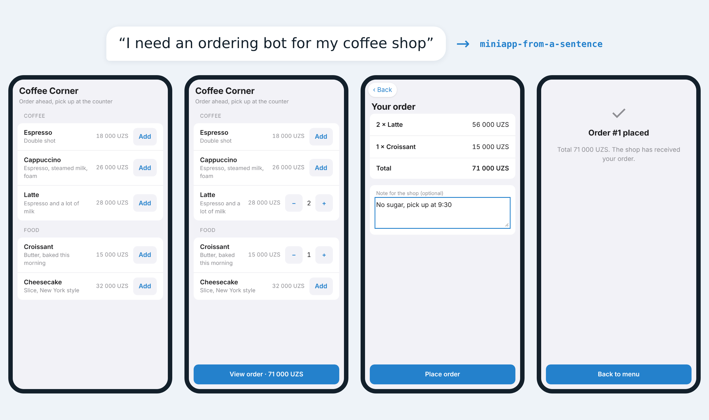
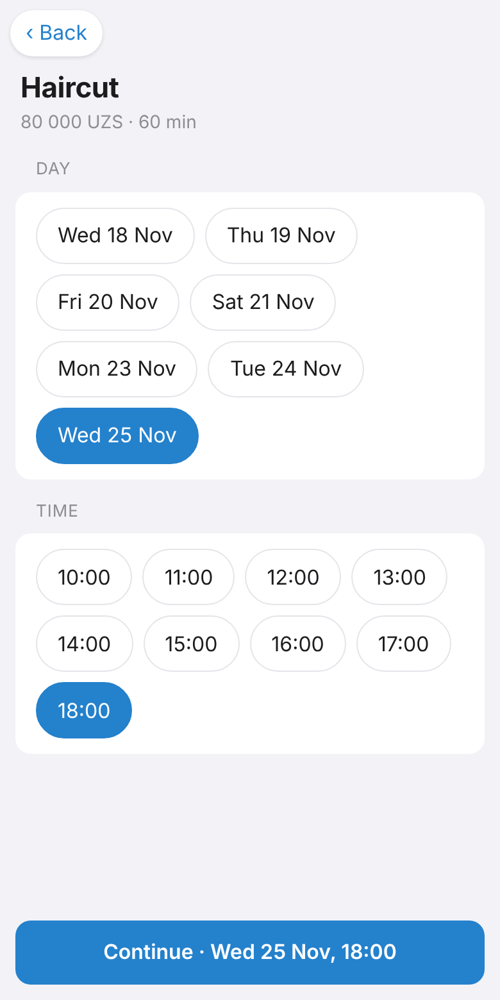
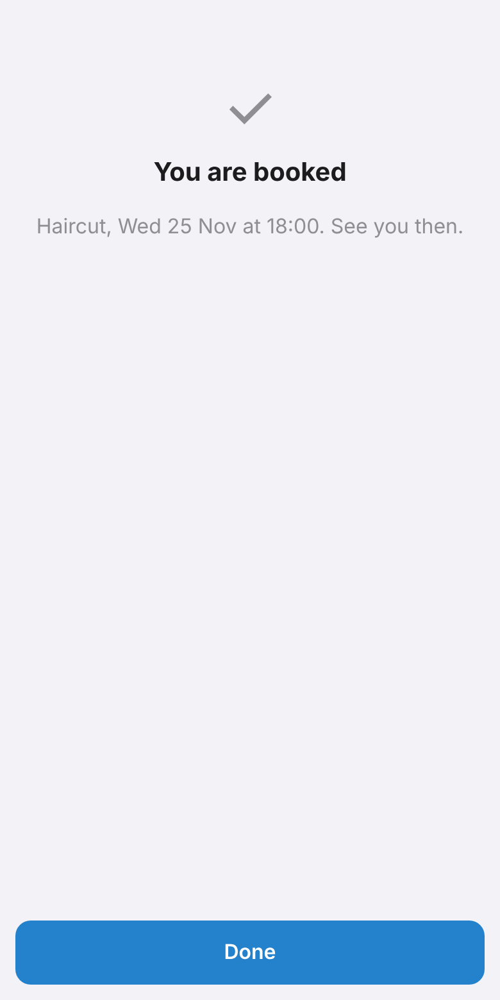
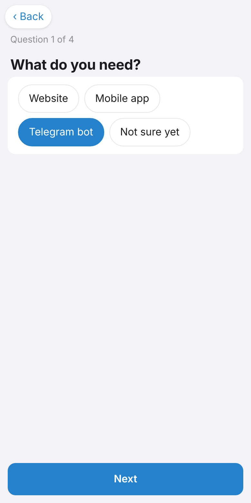
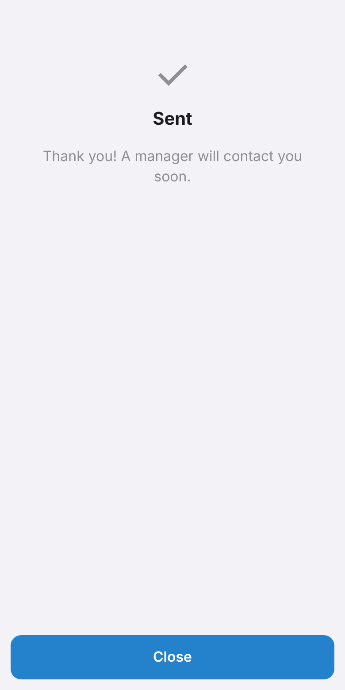
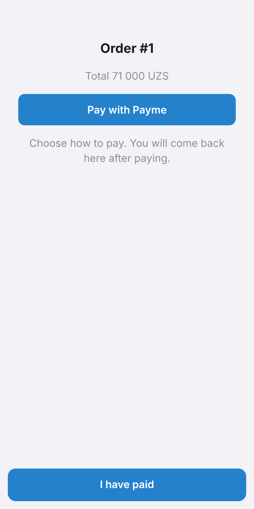
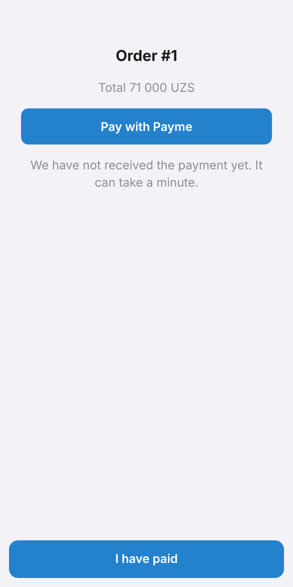
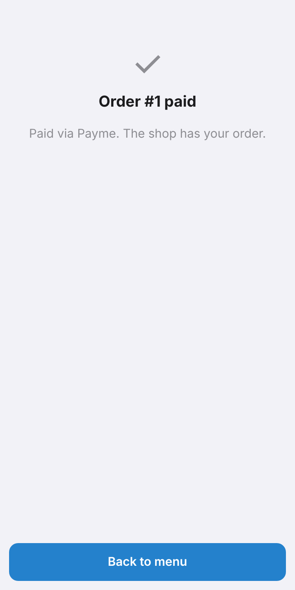

<p align="center">
  
</p>
<p align="center"><sub>Real screenshots of the <code>ordering</code> template, taken by the Playwright walkthrough in this repo.</sub></p>

<h1 align="center">miniapp-from-a-sentence</h1>

<p align="center">
  <b>Tell your coding agent "I need an ordering bot for my shop". Get a working, secure Telegram Mini App.</b><br>
  An agent skill with three tested templates (ordering, booking, survey), plain HTML/JS and a zero-dependency Node server.
</p>

<p align="center">
  <a href="https://github.com/MBotirjonDev/miniapp-from-a-sentence/actions/workflows/test.yml"></a>
  
  
  <a href="LICENSE"></a>
</p>

---

## Try it in 30 seconds

```sh
git clone https://github.com/MBotirjonDev/miniapp-from-a-sentence
node miniapp-from-a-sentence/skills/miniapp-from-a-sentence/scripts/new-app.cjs ordering my-shop
cd my-shop && npm run dev
```

Open http://localhost:3000. Without a bot token the app runs in **dev mode**: a mock Telegram
(MainButton, BackButton, theme colors) and a fake user whose initData is **signed by the server**,
so the real security check runs in a normal browser. Orders print in the terminal as the admin
message would look in Telegram.

## As an agent skill

```sh
cp -r miniapp-from-a-sentence/skills/miniapp-from-a-sentence ~/.claude/skills/
```

Then ask: *"Build a Telegram Mini App for booking haircuts"* or *"I need a lead form bot for my
agency."* The agent asks at most three questions (what is sold, who gets the orders, payments),
copies the closest template, fills in your data, tests the flow and gives you the BotFather steps.
Works with Claude Code, Codex, Cursor and any agent that reads `SKILL.md`.

## Three templates

| | `ordering` | `booking` | `survey` |
|---|---|---|---|
| For | shops, cafes, delivery | barbers, clinics, tutors | leads, applications, feedback |
| Flow | catalog → cart → order | service → day → slot → contact | one question per screen |
| Server rules | recomputes every price, max quantities | computes free slots, rejects a taken slot (409) | validates answers, one response per user |
| Admin gets | order with items and total | booking with name and phone | all answers |
| Payments | **Payme + Click built in** (optional) | | |

<p align="center">
  
  
  
  
</p>

Content lives in each template's `data.json` (items, services, hours, questions). Colors come from
Telegram's `themeParams`, so dark mode works without extra code.

## Payme and Click, built in

New in v0.2. The `ordering` template takes online payments through Payme and Click, the two payment
systems almost every shop in Uzbekistan uses. Set the keys from your merchant cabinets and the order
screen shows **Pay with Payme / Pay with Click**:

<p align="center">
  
  
  
</p>

- **Payme Merchant API**: all 7 JSON-RPC methods, the 12-hour timeout, idempotent retries, cancel
  before and after payment, `GetStatement`; Basic auth checked in constant time.
- **Click SHOP-API**: Prepare and Complete with the MD5 signature, exact amount check, repeats and
  failed charges handled.
- Money is an integer number of tiyin everywhere. The order turns `paid` only from these server
  callbacks, and the admin gets a "PAID" message.
- A zero-dependency JavaScript port of my Dart package [uz_payments](https://github.com/MBotirjonDev/uz_payments)
  (160/160 on pub.dev).

```sh
PAYME_MERCHANT_ID=...  PAYME_KEY=...  PAYME_TEST=1      # Payme sandbox
CLICK_SERVICE_ID=...   CLICK_MERCHANT_ID=...  CLICK_SECRET_KEY=...
```

Without keys the template works as before: orders are "pay on pickup".

## Security, built in

Most Mini Apps break in the same places. Each template:

- **validates initData on the server for every API call** (HMAC with `WebAppData`, constant-time compare, 1-hour expiry)
- **takes the user id only from validated initData**, never from the body or `initDataUnsafe`
- **recomputes prices and re-checks slots on the server**; the client sends ids and quantities
- marks an order **paid only from Payme/Click server callbacks** with a valid key or signature
- keeps the **bot token in the server environment** only, and refuses to start in production without it
- protects the **bot webhook with `secret_token`**
- **escapes user text** in admin messages and renders it with `textContent`
- limits body size, quantities, text length and phone format

The full checklist is in [references/security.md](skills/miniapp-from-a-sentence/references/security.md).
[telegram-miniapp-audit](https://github.com/MBotirjonDev/telegram-miniapp-audit)'s scanner reports two
leads in the ordering client, both checked by hand and not vulnerabilities: the "paid" screen only
displays the status the server set from Payme/Click callbacks, and the opened link is the server's
own checkout URL.

## How it was tested

- **31 unit and API tests** (`npm test`), including Payme and Click flows (wrong key, bad signature, wrong amount, double payment, timeout, refunds), forged user ids, another bot's token, expired
  initData, client-side price tampering, double booking, duplicate survey answers, webhook without
  the secret, path traversal, and that the dev mock is off when a real token is set.
- **A Playwright walkthrough** (`node scripts/walkthrough.cjs`) opens each template at phone width,
  clicks through the whole flow, checks the admin message, and saved the screenshots above.
- CI runs both on every push.

## Going live

The user does these steps; the skill never creates bots or handles real tokens:
create the bot in @BotFather, host the folder on any Node 18+ HTTPS host, set `BOT_TOKEN`,
`ADMIN_CHAT_ID`, `WEBHOOK_SECRET`, `WEBAPP_URL`, and set the bot's Menu Button to the app URL.
For payments, add the Payme/Click keys and give Payme `<WEBAPP_URL>/payments/payme` and Click
`<WEBAPP_URL>/payments/click`.
Details: [references/deploy.md](skills/miniapp-from-a-sentence/references/deploy.md).

## Honest limits

- **Storage is in memory.** Order numbers, bookings and survey answers reset on restart. Add a
  database before real customers.
- **Payments need a registered business.** Payme and Click keys come from their merchant
  cabinets, which require an LLC or sole proprietor. The handlers are tested against the specs
  and Payme-style calls, not yet against a live merchant account.
- **Tested in a browser with a mock, not inside the Telegram client.** The mock follows the
  WebApp API the templates use; test on a phone before launch.

## More from me

- [telegram-miniapp-audit](https://github.com/MBotirjonDev/telegram-miniapp-audit): security audit skill for Telegram bots and Mini Apps
- [flutter-senior-review](https://github.com/MBotirjonDev/flutter-senior-review): write, review and port Flutter like a senior
- [uz_payments](https://github.com/MBotirjonDev/uz_payments): Payme and Click payments for Dart and Flutter

---

<p align="center">MIT · made by <a href="https://github.com/MBotirjonDev">Botirjon</a>, who builds Telegram bots and Mini Apps for small businesses in Uzbekistan</p>
